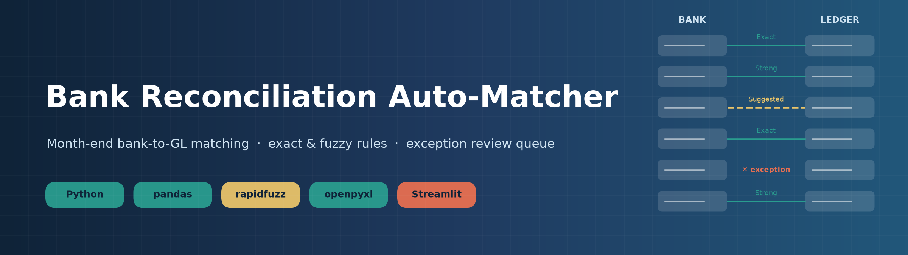
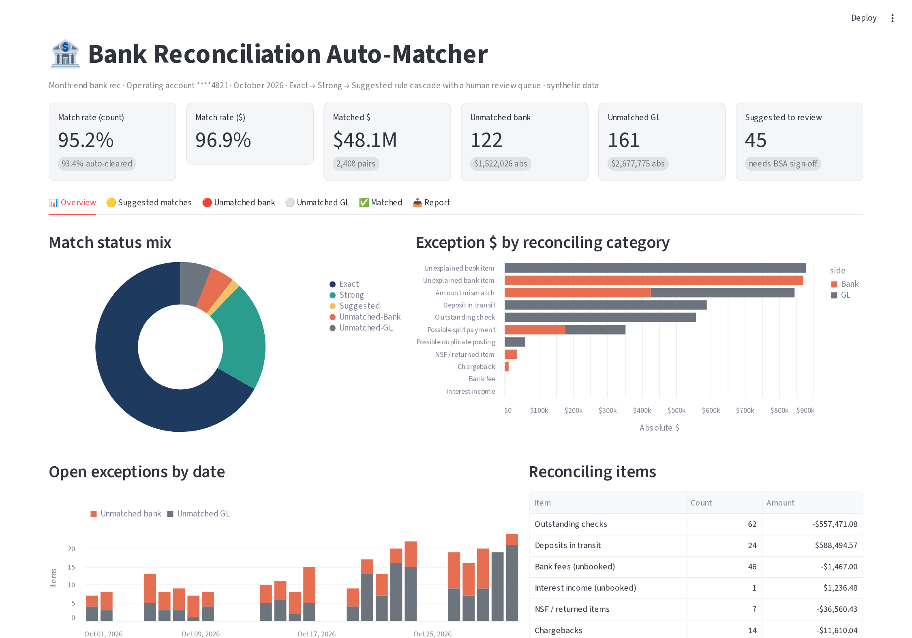
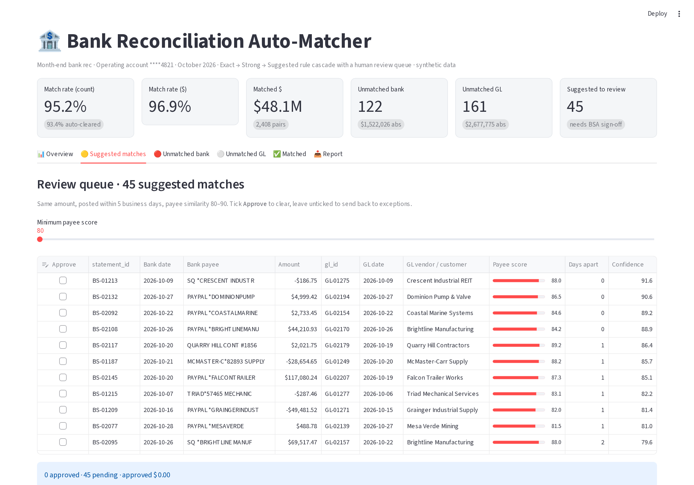
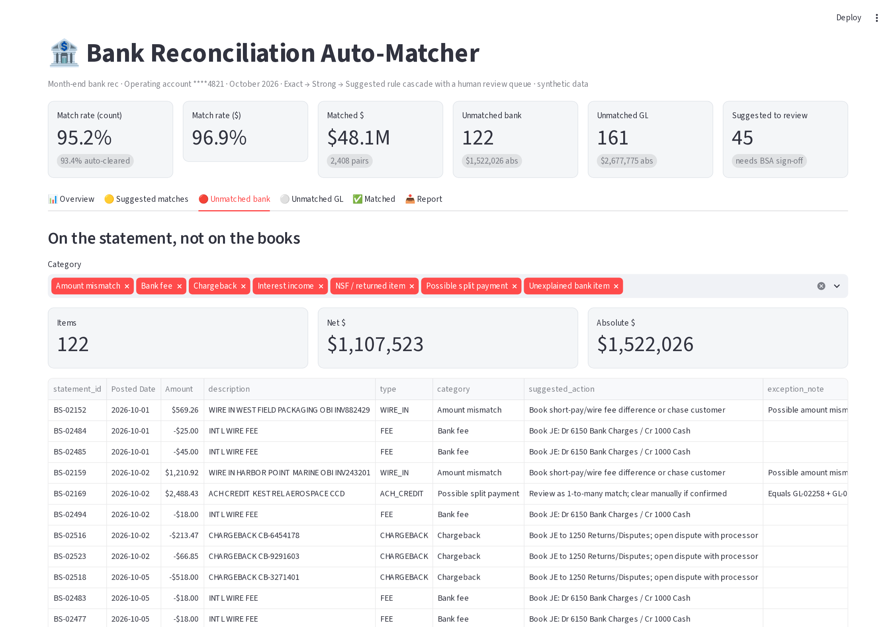
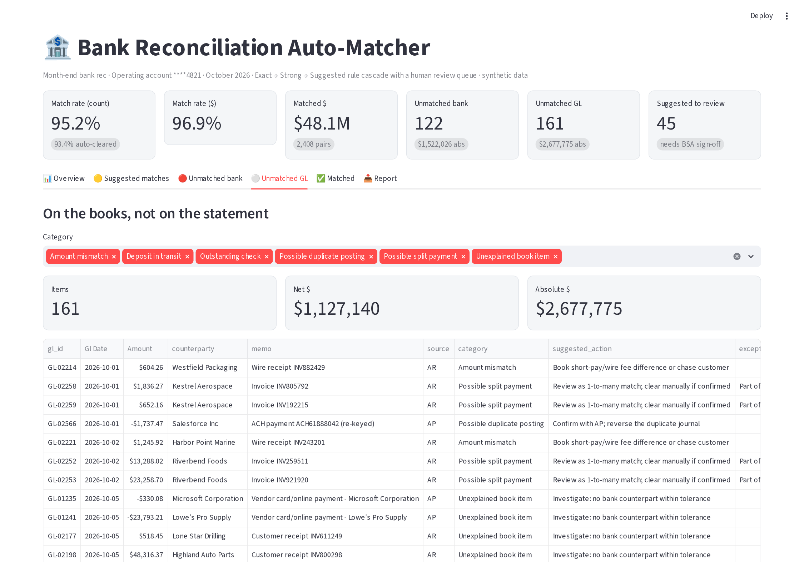
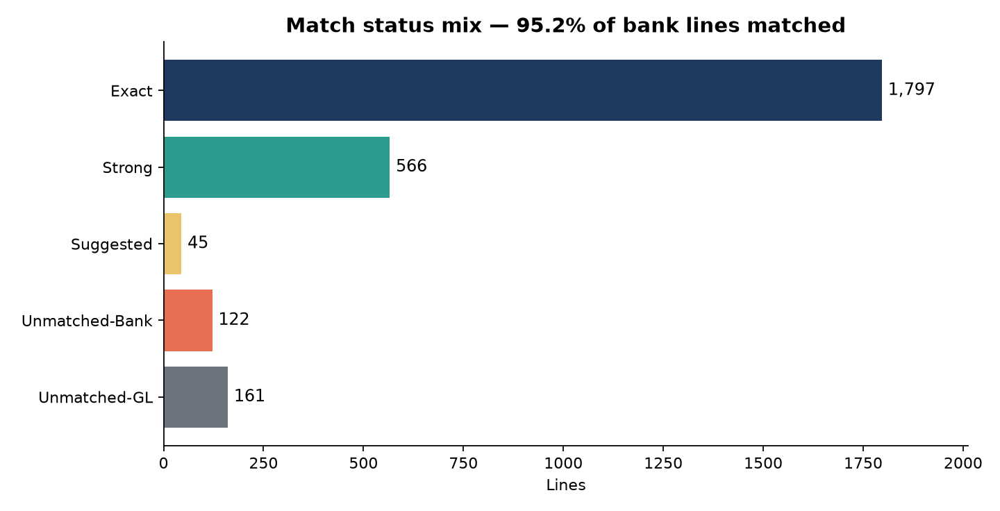
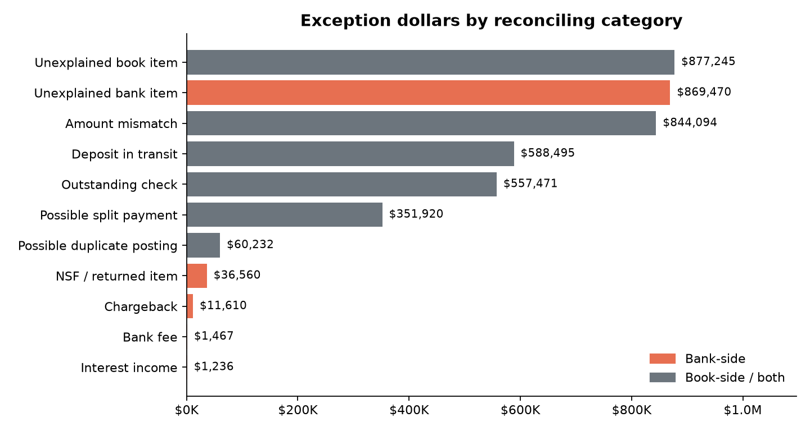
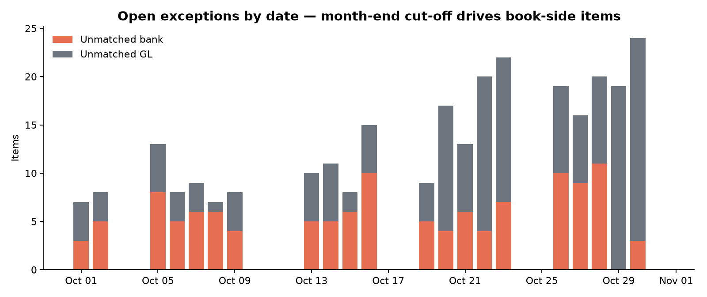
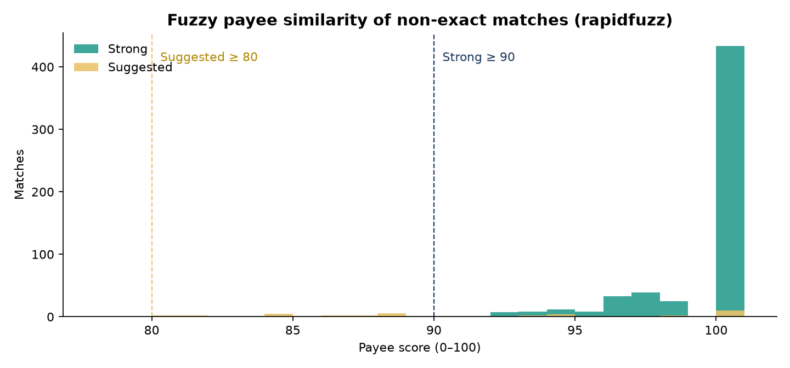

<p align="center"></p>

# 🏦 Bank Reconciliation Auto-Matcher

[](https://www.python.org/)
[](https://pandas.pydata.org/)
[](https://github.com/rapidfuzz/RapidFuzz)
[](https://streamlit.io/)
[](tests/)
[](LICENSE)

A month-end **bank-to-general-ledger matching tool**. It matches every bank statement line against cash-account (1000) entries in the GL with a clear **Exact → Strong → Suggested** rule cascade. It sorts what is left into standard reconciling items, sends uncertain pairs to a **human review queue**, and writes an **audit-ready Excel workbook** for the controller. A **Streamlit** app gives the reviewer KPIs, charts and the exception queues in one place.

> **Sample-run result (Oct 2026, synthetic data, seed 42):** **95.2%** of 2,530 bank lines matched (**96.9% by dollars**). **93.4%** cleared automatically with **100% precision** against the generator's ground truth. 45 suggested matches go to review, and 283 exceptions are sorted into reconciling categories.

---

## 📌 The problem

Month-end bank reconciliation is still mostly manual in many finance teams. An analyst exports the bank statement and the GL cash detail, then ticks items off in Excel. Thousands of lines line up easily, but the rest take days. **Timing differences** mean the bank posts an ACH two days after AP booked it. **Messy payee strings** don't look like the vendor master (`PAYPAL *ACMESTEEL LLC` vs. `Acme Steel LLC`, `AMAZON.COM*2K8R3` vs. `Amazon Web Services`). **Bank-only items** such as fees, interest, NSF returns and chargebacks have no journal entry yet. **Book-only items** such as outstanding checks and deposits in transit haven't hit the bank. On top of that come duplicates, short-paid wires and split payments. Close slips, and there is little audit trail showing *why* two lines were paired.

## ✅ What it does

| Step | What happens |
|---|---|
| **1. Ingest** | Loads `bank_statement.csv` and `general_ledger.csv` (cash account 1000 with offsetting AP/AR/expense/payroll/revenue accounts). |
| **2. Match** | Runs a documented **rule cascade**, strictly **1:1**, ranked by confidence and then date proximity. Each pair records *which rule fired*, a confidence score, the date gap, the payee similarity and whether the references matched. |
| **3. Guard rails** | Bank-originated items (fees, interest, NSF, chargebacks) can **only** match a GL entry booked to a bank-charge, interest or returns account. They are never paired with a vendor payment just because the amount is the same. |
| **4. Classify** | Open items become reconciling items: outstanding checks, deposits in transit, bank fees, interest, NSF, chargebacks, amount mismatches, possible duplicates and **possible split payments** (one bank credit = two open invoices). Each one gets a suggested next action (for example *"Book JE: Dr 6150 Bank Charges / Cr 1000 Cash"*). |
| **5. Report** | Writes a formatted 6-tab **Excel workbook** and README charts, and feeds the **Streamlit review app**. |

## 📸 Screenshots

**Overview:** KPI cards, match-status mix, exception dollars by category, open items by date and the reconciling-items summary.


**Suggested-match review queue:** the pairs the engine is *not* sure enough to auto-clear. Payee score, days apart and confidence are shown so the reviewer can approve or reject each one.


**Unmatched bank exceptions:** each item has a category, a suggested action and notes such as *"Possible amount mismatch vs GL-02214 (diff $35.00)"* or *"Equals GL-02258 + GL-02259"*.


<details>
<summary>More views: unmatched GL and pipeline charts</summary>



| | |
|---|---|
|  |  |
|  |  |

</details>

### 📗 The Excel workbook (`output/reconciliation_report.xlsx`)

| Tab | Contents |
|---|---|
| **Summary** | KPIs, match rate by count and $, rule breakdown, reconciling items, an activity balance proof (difference = $0.00), a short written summary and a pie chart |
| **Matched** | Bank and GL side by side, with rule, confidence, date difference, payee score and reference flag |
| **Suggested Matches** | The review queue, sorted by confidence, with blank *Reviewer Decision / Initials* columns for sign-off |
| **Unmatched Bank** | Statement items not on the books, with category, suggested action and notes |
| **Unmatched GL** | Book items not on the statement (outstanding checks, DIT, duplicates, etc.) |
| **Reconciling Items** | Summary by category and side, plus full detail and a bar chart |

Every tab has frozen headers, auto-filters, currency formats and color-coded tabs (navy = summary, teal = cleared, amber = review, red = exceptions).

## 🧑‍💼 How a BSA / finance-ops team would use it

1. **Day 1 of close:** drop the bank statement export and GL cash detail into `data/` and run `python pipeline.py`.
2. **Auto-clear:** Exact and Strong matches (93% of lines here) need no further work. The *Matched* tab is the audit trail.
3. **Review:** an analyst works the **Suggested** queue in the app or workbook, approving or rejecting each pair. Thresholds live in one block at the top of `src/matcher.py`, so the business can tune policy (for example, Strong ≥ 90 → 92) without touching the logic.
4. **Book adjustments:** the *Unmatched Bank* tab lists the JEs to post (fees, interest, NSF reversals, chargebacks).
5. **Investigate:** amount mismatches, duplicates and split payments go to AP/AR owners.
6. **Sign-off:** the controller reviews the Summary tab and files the workbook with the close binder.

In a production rollout this would be framed as user stories and acceptance criteria. Examples: *"As a staff accountant I can see why two lines were matched"* and *"bank fees are never auto-matched to vendor payments"*. The rules and thresholds would be agreed with the controller, and `tests/` would act as the UAT regression pack.

## 📊 Match results on the included sample data

October 2026 for a fictional mid-size manufacturer (*Northwind Fabrication Co.*), one operating account. **All data is synthetic** and comes from `src/generate_data.py` with a fixed seed. No real company, bank or employer data is used.

| Metric | Value |
|---|---|
| Bank statement lines | **2,530** |
| GL cash (1000) lines | **2,569** |
| Exact matches | **1,797** |
| Strong matches | **566** |
| Suggested (review queue) | **45** |
| Match rate by count (bank lines) | **95.2%** |
| Match rate by dollars | **96.9%** ($48.1M of $49.7M absolute) |
| Auto-cleared (Exact + Strong) | **93.4%** of bank lines |
| Auto-cleared precision vs. ground truth | **100.0%** (no wrong auto-clears) |
| Unmatched bank / GL | **122** ($1.52M abs) / **161** ($2.68M abs) |
| Total exceptions | **283 items · $4,199,801.51** absolute |

**Reconciling items**

| Category | Side | Items | Amount |
|---|---|---:|---:|
| Outstanding checks | GL | 62 | −$557,471.08 |
| Deposits in transit | GL | 24 | $588,494.57 |
| Bank fees (unbooked) | Bank | 46 | −$1,467.00 |
| Interest income (unbooked) | Bank | 1 | $1,236.48 |
| NSF / returned items | Bank | 7 | −$36,560.43 |
| Chargebacks | Bank | 14 | −$11,610.04 |
| Amount mismatches (short-paid wires) | Bank / GL | 19 / 18 | $425,721.92 / $418,371.95 |
| Possible split payments | Bank / GL | 11 / 22 | $175,959.86 each side |
| Possible duplicate postings | GL | 9 | −$60,232.43 |
| Unexplained (needs investigation) | Bank / GL | 24 / 26 | $554,242.32 / $562,017.29 |

> The generator also writes `data/ground_truth.csv` (the intended pairing for every line). It is used **only** to score the engine and is never read by the matcher. The engine recovers 98.3% of intended 1:1 pairs. The rest are messy payee strings that score below 80 and correctly fall to the exception queue instead of being guessed.

## 📐 Matching rules

| # | Rule | Amount | Reference / check no. | Date window (business days) | Payee similarity | Outcome |
|---|---|---|---|---|---|---|
| 1 | **Exact** | equal | equal | ≤ 1 (checks: ≤ 15 clearing window) | – | Auto-cleared, confidence 100 |
| 2 | **Strong** | equal | – | ≤ 3 | ≥ 90 | Auto-cleared |
| 3 | **Suggested** | equal | – | ≤ 5 | ≥ 80 | **BSA review queue**, not cleared |
| – | **Unmatched** | – | – | – | – | `Unmatched-Bank` / `Unmatched-GL`, then classified |

* **Payee similarity** = 60% RapidFuzz `token_set_ratio` + 40% `partial_ratio` on normalized names. Noise such as `PAYPAL`, `SQ`, `ACH`, `INC`, `LLC` and store/reference numbers is removed first.
* **Confidence** = 70% payee score + 30% date proximity (Exact = 100).
* **1:1 greedy assignment:** every Exact pairing is made before any Strong, and every Strong before any Suggested. Within a rule, pairs are taken by confidence, then smallest date gap. A line that has been used can never match again, so recurring same-amount subscriptions pair with the right occurrence.
* **Business days** skip weekends and the Oct 12 bank holiday.

## 🚀 Quickstart

```bash
python -m venv .venv
source .venv/bin/activate          # Windows: .venv\Scripts\activate
pip install -r requirements.txt

python pipeline.py                 # generate data -> match -> Excel + charts
streamlit run app.py               # open the review app at http://localhost:8501
pytest                             # 11 tests
```

`python pipeline.py --no-generate` re-runs matching on whatever CSVs are in `data/`. Swap in your own exports with the same columns.
To refresh the README screenshots: `pip install playwright && playwright install chromium`, start the app on port 8599, then run `python scripts/screenshot_dashboard.py`.

## 🗂️ Data dictionary

**Bank statement:** `statement_id, trans_date, posted_date, amount, description, payee, reference (check no./trace), type (CHECK, ACH_DEBIT, ACH_CREDIT, WIRE_IN, WIRE_OUT, DEPOSIT, CARD_SETTLEMENT, CARD_DEBIT, PAYROLL, FEE, INTEREST, NSF, CHARGEBACK), bank_account`

**General ledger:** `gl_id, gl_date, amount, account (1000), offset_account, cost_center, counterparty (vendor/customer), memo, journal_id, source (AP, AR, PR, TR, GL), reference`

Amounts are signed from the company's point of view: deposits are positive and disbursements are negative.

## 🧱 Project structure

```
bank-reconciliation-auto-matcher/
├── pipeline.py                 # CLI: generate data, run matching, write Excel + charts
├── app.py                      # Streamlit exception-review app
├── src/
│   ├── generate_data.py        # seeded synthetic bank statement + GL + ground truth
│   ├── matcher.py              # rule cascade, guard rails, exception classification, KPIs
│   ├── excel_report.py         # 6-tab openpyxl workbook
│   └── charts.py               # matplotlib README charts
├── data/                       # bank_statement.csv, general_ledger.csv, ground_truth.csv
├── output/                     # reconciliation_report.xlsx + CSV/JSON used by the app
├── docs/images/                # banner, charts, dashboard screenshots
├── scripts/                    # make_banner.py, screenshot_dashboard.py (Playwright)
├── tests/test_matcher.py       # 11 pytest cases
├── requirements.txt
└── LICENSE
```

## 🛠️ Tech stack

**Python 3** · **pandas / NumPy** (data and business-day math) · **RapidFuzz** (fuzzy payee matching) · **openpyxl** (formatted Excel) · **Streamlit + Altair** (review app) · **matplotlib** (charts and banner) · **pytest** (tests) · **Playwright** (screenshots)

## 🔭 Possible next steps

* Approve/reject decisions written back to a matches log, so they persist between runs
* 1-to-many and many-to-1 matching for the split-payment hints
* BAI2 / camt.053 statement parsers and a direct GL extract
* Prior-period carry-forward of outstanding items and aging buckets

---

**Author:** Omkar Mahale · Business Systems Analyst · MS FinTech & Analytics
*Synthetic data only. Built as a portfolio project to show finance-operations process automation.*
